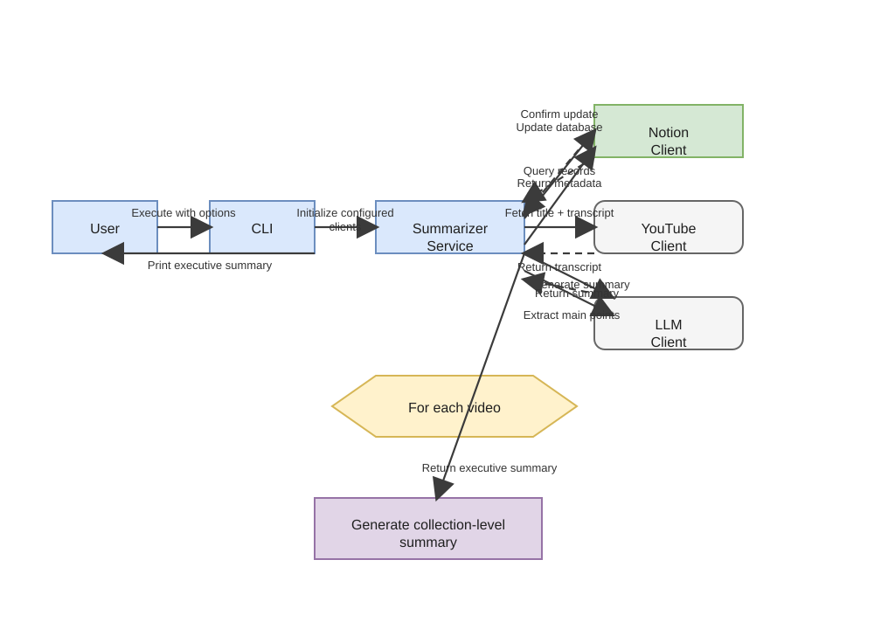

# How the processing pipeline works

The application treats a video as a record that can be enriched over time.
Storage backends supply existing records, the YouTube client supplies missing
metadata and transcript text, and the LLM client supplies the analysis fields.
The service compares the persisted fields before and after processing, so it
does not rewrite an unchanged video.

The source diagram is stored in the draw.io format at [../assets/processing-pipeline.drawio](../assets/processing-pipeline.drawio) and was converted from the Mermaid version to a draw.io-backed asset.

## Storage behavior

Notion and filesystem storage are independent backends.
Notion mode reads database rows and updates their persisted properties.
Filesystem mode writes an OKF bundle consisting of a root index, a playlist
index with an executive overview and linked talk table, a per-playlist
executive report, and one Markdown note per video. Video notes include the
summary, main points, and a linked YouTube thumbnail.
When both are configured, successful changes are written to both backends.

## Analysis behavior

Each video summary is limited to 2,000 characters and each main-points result is
limited to 2,000 characters by the prompts sent to the model.
The executive summary is limited to 6,000 characters.
Before each LLM request, Headroom attempts prompt compression. The client then
counts the complete prompt, including system instructions, against the model's
LiteLLM input-token limit, reserving 1,024 tokens for the response. Unknown models
use an 8,192-token fallback limit; unavailable tokenizers use a conservative
UTF-8 byte-based estimate with message overhead. Responses are capped at
1,024 tokens in addition to the character limits requested by the prompts.

If compression is unavailable, fails, or leaves the prompt too large, the client
splits the source into token-budgeted excerpts, summarizes them in order, and
combines the partial summaries. This map-reduce process works for every provider
and applies to video summaries, main points, and executive summaries.
Inputs that already fit need only one request.

The executive summary uses only non-empty video summaries.
Large collections are reduced in groups of 25 summaries until one result
remains.

## Failure boundaries

Transcript retrieval returns no transcript for age-restricted, unavailable,
unplayable, disabled, or unsupported-language videos, so those videos cannot be
analysed during that run.
Connection failures from the configured LLM endpoint become an actionable CLI
error and end the process with a non-zero exit status.
If reduction stops making progress, exceeds five passes, or the instructions
alone exhaust the budget, analysis fails explicitly rather than truncating the
source or sending a known oversized request. A model with a larger context
window may be needed.
